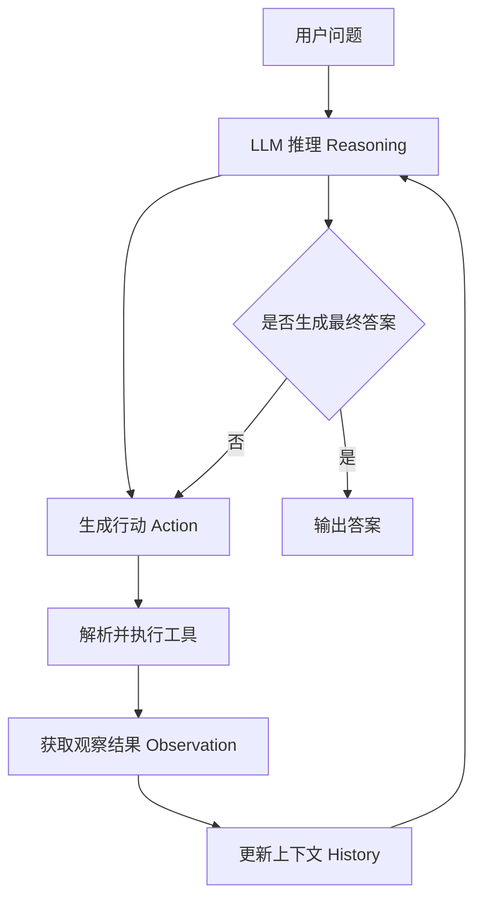
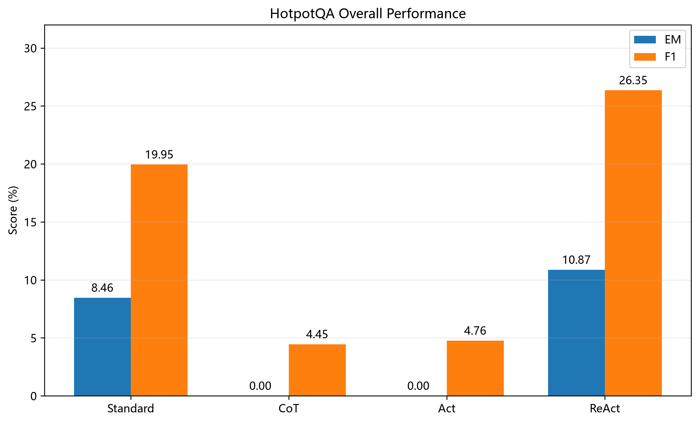
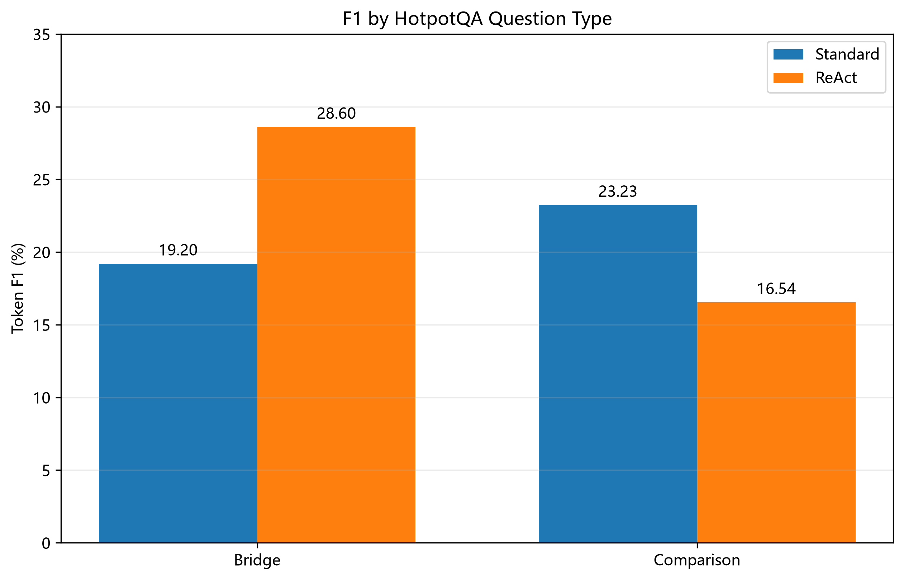
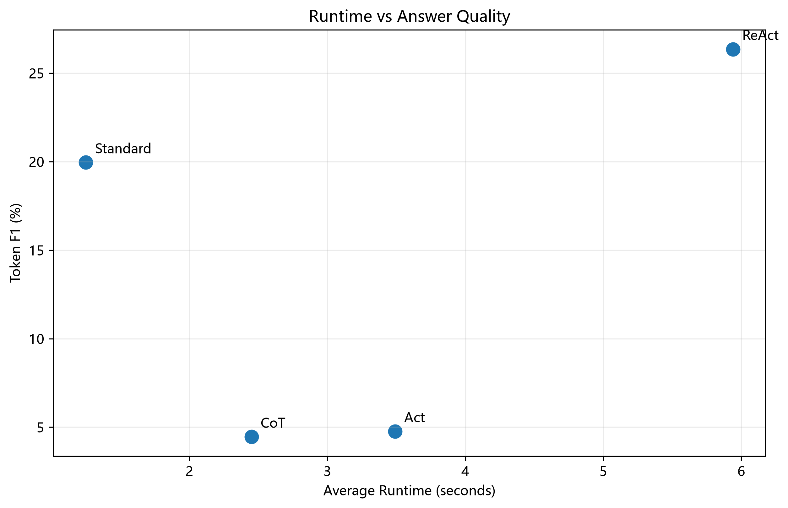
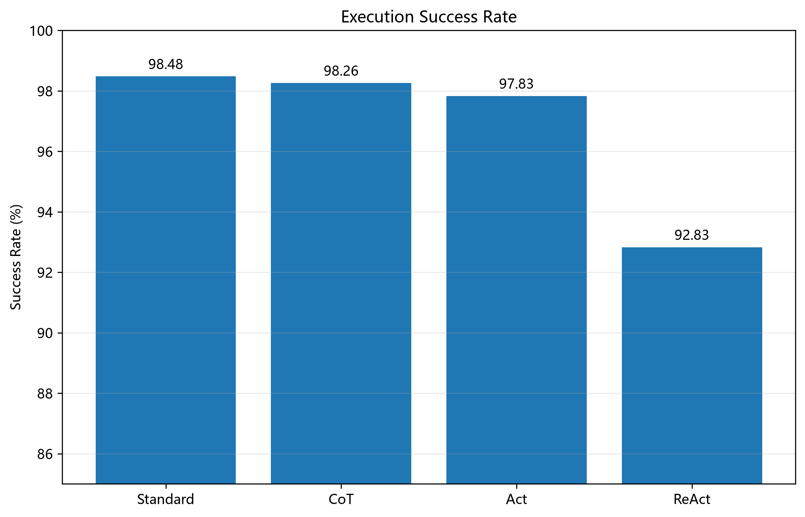

# ReAct Minimal Reproduction

一个以 DeepSeek API 的 ReAct 智能体最小实现项目，用于学习 LLM Agent 的基本工作机制，并通过 HotpotQA 数据集对比不同方法的问答表现。

## 1. 项目介绍

本项目参考论文：

**ReAct: Synergizing Reasoning and Acting in Language Models**

[论文地址](https://arxiv.org/abs/2210.03629)

使用 DeepSeek V4 Pro 接入 Wikipedia 工具，实现了一个简单的 ReAct Agent。

主要实现了以下机制：

**Reasoning（推理）**：LLM 根据当前问题和上下文决定下一步操作。
**Action（行动）**：解析 LLM 生成的行动指令，调用对应工具。
**Observation（观察）**：获取工具返回的信息，并反馈给 LLM。
**Loop（循环）**：重复上述过程，直到生成最终答案或达到最大执行步数。
**Context History（上下文记忆）**：保存之前的推理、行动和观察结果，供后续推理使用。

## 2. ReAct 核心流程



ReAct 的核心思想是让模型在推理过程中与外部环境交互，而不是只依赖模型内部已有的知识。

## 3. 核心实现

本项目主要通过三个部分实现 ReAct：

| 模块 | 作用 |
|---|---|
| `llm.py` | 接入 DeepSeek API，负责模型调用 |
| `react.py` | 实现推理、行动、观察及循环机制 |
| `search.py` | 提供 Wikipedia 搜索和页面查询工具 |

行动指令采用简单的文本解析方式，例如：

```text
Action: search_wikipedia[Alan Turing]
```

程序解析行动名称和参数，再调用对应的 Python 工具函数。

**与原论文的区别：**

- 使用单个 DeepSeek 模型完成推理和行动决策。
- 使用简单的文本解析实现工具调用，没有采用原生 Function Calling。
- 主要复现 ReAct 的核心交互机制，没有完整复现论文中的全部实验设置。

## 4. Baseline 对比实验

使用 HotpotQA 数据集，对比四种方法：

| 方法 | 实现方式 |
|---|---|
| Standard | 直接向 LLM 提问 |
| CoT | 让 LLM 先推理再回答 |
| Act | 先调用工具，再根据结果回答 |
| ReAct | 推理与工具行动交替进行 |

主要评价指标：

- **EM**：预测答案与标准答案完全匹配的比例。
- **F1**：预测答案与标准答案在 Token 层面的重合程度。
- **Runtime**：平均执行时间。
- **Success Rate**：任务执行成功率。

## 5. 实验结果

### 5.1 整体问答表现



### 5.2 不同问题类型的 F1 表现



### 5.3 执行时间与问答表现



### 5.4 执行成功率



### 实验数据

| Method | EM (%) | F1 (%) | Runtime (s) | Success Rate (%) |
|---|---:|---:|---:|---:|
| Standard | 8.46 | 19.95 | 1.25 | 98.48 |
| CoT | 0.00 | 4.45 | 2.45 | 98.26 |
| Act | 0.00 | 4.76 | 3.49 | 97.83 |
| ReAct | **10.87** | **26.35** | 5.94 | 92.83 |

### 初步分析

ReAct 在当前实验中取得了最高的 EM 和 F1。
ReAct 的平均执行时间更长，说明多轮推理和工具调用会带来额外开销。
ReAct 在 Bridge 类型问题上表现较好，但在 Comparison 类型问题上没有超过 Standard。
CoT 和 Act 的结果异常偏低，后续还需要检查答案提取和评价流程。

*注：当前结果来自已有实验记录，各方法的样本数量并非完全一致，因此属于初步实验结果。*

## 6. 项目结构

```text
react-reproduction/
├── agent/
│   ├── llm.py
│   └── react.py
├── tools/
│   └── search.py
├── experiments/
│   └── baselines.py
├── evaluation/
│   ├── run_experiment.py
│   ├── metrics.py
│   ├── run_hotpotqa.py
│   └── metrics_hotpotqa.py
├── data/
├── visualization/
│   └── plot_hotpotqa.py
└── results/
    ├── hotpotqa_results.csv
    └── visualization/
```

## 7. 复盘

在实现过程中，我进一步理解了 ReAct 的几个关键问题：

推理、行动和观察之间如何形成循环。
工具返回的信息如何进入上下文，并影响下一轮决策。
原论文通过 `stop=["\nObservation:"]` 等生成控制方式，避免模型自行生成 Observation，减少伪造工具结果的风险。
文本解析式工具调用与原生 Function Calling 的区别。

